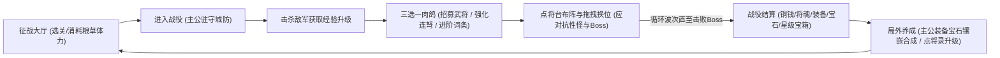
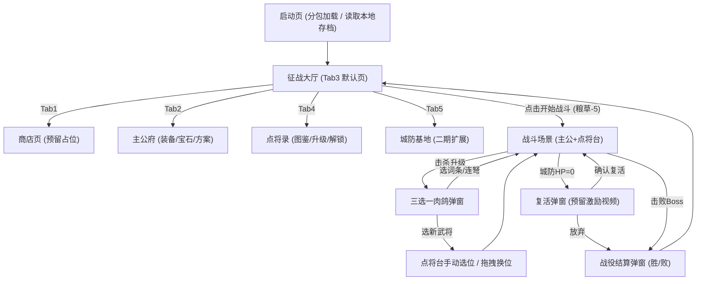

# 《主公别放箭》（暂定名）三国肉鸽塔防微信小游戏 — 详细功能开发文档

> **文档版本**：v1.2（MVP 1.0 落地明细 + 完整商业化扩展框架；最新代码改动台账见 [MVP_1.0_功能实现与改动记录.md](file:///h:/sanguo_tafang/docs/MVP_1.0_功能实现与改动记录.md)）  
> **运行平台**：微信小游戏（竖屏 750×1334）  
> **客户端技术栈**：Cocos Creator 3.8.x + TypeScript  
> **数据与后端演进**：Phase 1 本地存储（`IDataRepository` 抽象） → Phase 2 PHP (ThinkPHP 8) + MySQL 8  

---

## 目录

- [1. 项目总览与核心设计映射](#1-项目总览与核心设计映射)
- [2. 核心战斗与肉鸽系统（玩法详解）](#2-核心战斗与肉鸽系统玩法详解)
- [3. 三国武将体系（MVP 首批 12 位名将全案）](#3-三国武将体系mvp-首批-12-位名将全案)
- [4. 三维抗性克制、数值公式与 10 大战役关卡/Boss](#4-三维抗性克制数值公式与-10-大战役关卡boss)
- [5. 主公装备与宝石养成系统（对标《向僵尸开炮》）](#5-主公装备与宝石养成系统对标向僵尸开炮)
- [6. 武将解锁与点将录局外养成](#6-武将解锁与点将录局外养成)
- [7. UI 界面结构与交互流转规范](#7-ui-界面结构与交互流转规范)
- [8. Cocos Creator 3.x + TS 客户端架构与微信小游戏性能优化](#8-cocos-creator-3x--ts-客户端架构与微信小游戏性能优化)
- [9. 数据存储、本地存档与 ThinkPHP + MySQL 后端预留](#9-数据存储本地存档与-thinkphp--mysql-后端预留)
- [10. 广告与商城系统预留、分期里程碑及验收清单](#10-广告与商城系统预留分期里程碑及验收清单)

---

## 1. 项目总览与核心设计映射

### 1.1 游戏定位与核心玩法
本作是一款融合 **“防线守城 + 点将台塔防 + 局内肉鸽三选一 + 局外装备宝石养成”** 的三国题材竖屏微信小游戏。
- **核心爽点**：玩家扮演乱世主公驻守城墙，手持连弩自动退敌；击杀敌军升级后，通过肉鸽三选一招募三国名将登上战场“点将台”，或强化主公连弩与武将流派词条；后期形成弹幕横飞、火海雷暴、无双割草的解压战斗体验。
- **策略深度**：点将台空间有限且每位名将**射程、对空能力、元素属性、技能特效**迥异，结合怪物**物理/远程/法术/空中**抗性克制与独立机制 Boss，需要玩家在局内灵活拖拽换位、针对性构筑技能树，并在局外搭配多套装备宝石方案。

### 1.2 核心玩法循环（Core Loop）



### 1.3 参考图与《向僵尸开炮》融合映射表

| 参考图 / 对标模块 | 原图表现特征 | 本作三国化改造方案 |
| :--- | :--- | :--- |
| **图 1：征战主大厅** | 顶部头像/钻石/金币/体力(50/50)；中部当前关卡与 3 星通关宝箱；底部普通/挑战切换、巡逻、开始战斗、底部 5 Tab | 顶部主公头像等级/元宝/铜钱/粮草(50/50)；中部“第 X 关”三国战役+三星宝箱（通关/50%血量/完美守城）；主公与已上阵名将站位巡检动画；底部 5 Tab（商店/主公/征战/武将/城防） |
| **图 2：战斗初始态** | 底部防线主角自动射击，战场分布 6~8 个固定空位，顶部波次进度条、暂停、倍速、怪物/伤害按钮，底部 HP 与等级经验条 | 底部城墙主公自动连弩射击；战场分布 6~8 个**八阵图/点将台空位**；顶部显示关卡波次进度条（含精英/Boss旗帜）、延迟与耗时；底部显示城防血条（初始 3200）与主公经验等级条 |
| **图 3：升级三选一** | 半透明遮罩弹出 3 张能力卡，标注“新”“可对空”，底部提供广告刷新按钮与右下角“查看战况” | 升级弹出 3 张三国卡（武将招募卡 / 连弩强化卡 / 武将词条卡），左上角醒目标注 `新`、`可对空`、`近战`、`无双` 等标签；底部预留广告“刷新”与“全都要”；右下角支持透视战场 |
| **图 4：中后期战斗态** | 场上多个单位同时释放激光/散射/导弹弹幕，右侧竖排显示已选单位图标与等级数字，右下角提供“自动”开关 | 赵云长枪突刺、黄忠贯日长箭、周瑜赤壁火海、诸葛亮九天落雷同屏交织；右侧竖排显示已上阵名将头像与局内词条层数；支持长按武将拖拽换位与“自动托管” |
| **图 5：角色装备与宝石** | 左侧天赋/角色/信物/枪械入口，中间人物立绘与战力值，右侧 6 部位装备（阶数+强化等级+5宝石孔），下方宝石/装备/材料切换与一键合成 | 改版为**主公府**：中间主公持弩立绘+总战力，右侧 **玉佩/扳指/战甲/战裙/战靴/护腕** 6 部位（每部位 5 宝石孔，支持方案 1/2/3 切换与装备改良）；下方宝石库支持 **5 合 1 一键合成** |
| **图 6：图鉴解锁与升级** | 上方 NPC 提示“提升等级永久提升暴击伤害”，下方阶梯架展示已解锁/等级锁定单位（6/9/13/17/22/27/32级解锁） | 改版为**点将录（武将）**：军师/名将 NPC 提示全局暴击伤害加成；阶梯展示 12 位名将解锁条件（主公等级 / 战役首通 / 将魂合成）与局外等级 |

### 1.4 屏幕与微信小游戏安全区规范
- **设计分辨率**：`750 × 1334`（竖屏，采用 `FIT_WIDTH` 适配宽屏窄屏，背景底图延伸至 `750 × 1624` 防止超长全面屏露黑边）。
- **顶部安全区**：避开微信小游戏右上角胶囊按钮（固定预留顶部 `90px` 区域，顶部信息栏下移至胶囊下方或左对齐）。
- **底部安全区**：全面屏底部 Home Indicator 预留 `34px` 留白，底部 5 Tab 栏高度 `110px`。

---

## 2. 核心战斗与肉鸽系统（玩法详解）

### 2.1 战场空间结构与点将台布局
- **战场分区**（自上而下）：
  1. **出兵区（Y: 1120~1250）**：1~3 个敌军出兵口（营寨/山道/渡口）。
  2. **行军通道与点将台区（Y: 320~1120）**：敌军沿预设 `Waypoint` 路径向城墙推进；地图中散布 **6~8 个固定点将台**，按战术位置分为三类：
     - **前排咽喉位（2~3 个）**：靠近出兵口或双路交汇点，适合放置赵云、张飞、关羽、吕布等近战/短射程高爆发或强控武将。
     - **中排枢纽位（2~3 个）**：覆盖主干道大面积区域，适合放置周瑜、郭嘉、貂蝉、华佗等范围法术/辅助武将。
     - **后排高台位（2 个）**：靠近城墙且视野开阔，适合放置黄忠、诸葛亮、黄月英、贾诩等超长射程或全屏输出武将。
  3. **主公城防阵地（Y: 160~320）**：城墙防线横跨底部，主公位于阵地中央（`X: 375, Y: 240`）。敌军抵达城墙前缘（`Y <= 290`）后停止前进或贴墙攻击，每秒对城防造成一次伤害（远程攻城怪则在射程内停下炮击）。

### 2.2 主公视角自动战斗与经验升级
- **主公基础攻击**（v1.2 黄金平衡：定位防线补刀，核心输出交给三国名将）：
  - 射程：限制在中下半场防线（`LORD_RANGE = 560px`，战场上以淡淡的金色警戒弧标注），不抢上半场弯道武将的怪。
  - 索敌策略：默认“距离城墙最近优先”（确保优先清理威胁防线的怪物），可受特定词条影响改为“首领优先”或“最低血量优先”。
  - 普攻形态：发射连弩箭矢，基础倍率 `0.62`、攻击间隔 `0.78s`、自带 `22%` 基础破甲，可通过局内连弩词条质变为多发齐射、穿透重箭、追踪火箭或麻痹雷箭。
- **开局点将与局内经验升级曲线**：
  - **天生开局送 1 次免费点将三选一**（若镶嵌玉佩开局宝石则叠加为 2 次），彻底杜绝 0 武将裸开局死锁。
  - 击杀怪物直接掉落经验值（小兵 `16~25 EXP`，精英 `60~100 EXP`，Boss `220~650 EXP`）。
  - 升级所需经验公式：`ExpNeeded(L) = 35 + 30 * (L - 1) + 5 * (L - 1)^2`（1 级升 2 级仅需 35 经验，前 3 级杀 2~3 个小兵即可迅速选技能）。

### 2.3 随机推荐坑位 + 任意非道路空地随意放置与拖拽规则
1. **名将唯一上阵原则**：
   - 单局内每位三国名将最多在场上存在 **1 位**（如已招募赵云，后续三选一不会再出现“招募新赵云”，而是转为出现【赵云专属词条强化】），单局最多同时上阵 `8` 位名将。
2. **随机推荐黄金坑位 + 任意空地自由放置**：
   - 每局开局基于本关曲折路径动态随机采样生成 `7~8` 个**黄金推荐坑位**（以虚线八阵环提示，靠近时自动轻吸附）。
   - 同时放开**全图任意非道路空地随意放置**：只要在布阵区（`x ∈ [65, 685], y ∈ [325, 1085]`）、距道路线段 `>= 46px`、距其他武将 `>= 62px`，任意空地均可点击放置；选位或拖动时实时显示 **翡翠绿合法圈 / 警戒红禁放圈** + **真实攻击范围圆圈（`RangeCircle`）**，右上角同时提供“智能推荐布阵”快捷按钮。
3. **局内自由拖拽调阵**：
   - 战斗任意非暂停时刻，按住场上任意已上阵武将即可自由拖至**任意合法空地**实现转移，或拖至**另一位已上阵武将**身上触发**位置互换**（换位也可直接挣脱司马懿的禁锢）。
   - 换位冷却时间：`1.5秒`。
4. **自动托管模式**：
   - 点击战场右下角 `自动` 按钮后：新抽到的武将自动按推荐位置上阵；若触发升级三选一且 5 秒未操作（或开启全自动），按预设优先级自动选取词条。

### 2.4 升级三选一肉鸽系统与权重算法

#### 2.4.1 卡池三大分类
1. **新武将招募卡**（标有 `新`、`近战/远程`、`可对空` 角标）：最多出现已解锁且本局未上阵的武将。
2. **主公连弩强化卡**（7 大方向，可叠加）：
   - `连发齐射`（每次攻击额外发射 +1 支弩箭，角度微散）
   - `重弩穿甲`（弩箭穿透敌人数 +1，对重甲额外伤害 +15%）
   - `神速连射`（主公攻速 +20%）
   - `火箭附魔`（普攻附带火焰爆炸，小范围溅射 + 灼烧，可破藤甲）
   - `雷电麻痹`（命中概率触发小范围落雷并麻痹 0.5s）
   - `弱点暴击`（主公暴击率 +12%，暴击伤害 +30%）
   - `城防固守`（立刻回复 20% 城防血量，并提升 10% 城防减伤，仅在城防血量 < 80% 时高权重出现）
3. **武将专属词条进阶卡**：每位上阵武将拥有 4~6 个专属词条（含 1 个需前置条件解锁的**无双超武词条**）。

#### 2.4.2 动态权重抽取伪代码
```typescript
function drawThreeCards(state: BattleState): RogueCard[] {
  const pool: WeightedCard[] = [];

  // 1. 新武将卡：前3级且场上武将<3人时，权重翻倍保底防卡手
  if (state.deployedHeroes.length < state.maxSlots) {
    const newHeroWeight = (state.level <= 3 && state.deployedHeroes.length < 2) ? 260 : 120;
    for (const hero of state.unlockedUndeployedHeroes) {
      pool.push({ type: 'NEW_HERO', heroId: hero.id, weight: newHeroWeight });
    }
  }

  // 2. 主公连弩卡：权重 90~110（血量危急时“城防固守”权重提升至 150）
  for (const lordSkill of state.availableLordSkills) {
    if (!lordSkill.isMaxLevel()) {
      pool.push({ type: 'LORD_SKILL', skillId: lordSkill.id, weight: lordSkill.calcWeight(state) });
    }
  }

  // 3. 已上阵武将词条卡：仅抽取前置条件满足、且局外等级已解锁的词条
  for (const hero of state.deployedHeroes) {
    for (const affix of hero.getAvailableAffixes(state.playerHeroLevels)) {
      const weight = affix.isSuperWeapon ? 80 : 130;
      pool.push({ type: 'HERO_AFFIX', heroId: hero.id, affixId: affix.id, weight });
    }
  }

  // 不放回加权随机抽取 3 张（前3级保底至少包含1张NEW_HERO或高优先级战斗卡）
  return weightedSampleWithoutReplacement(pool, 3);
}
```

### 2.5 战斗 HUD 与辅助面板
- **顶部栏**：暂停按钮、波次进度条（`0% ~ 100%`，关键波次标有精英/Boss 骷髅旗帜）、当前实时耗时与网络状态（单机模式显示本地图标）。
- **左侧功能列**：
  - `倍速`：支持 `x1.0` / `x1.5` 免费切换，`x2.0` 预留激励视频解锁槽位。
  - `怪物`：点击暂停并弹窗展示本关即将出现的所有怪物图鉴、抗性与弱点提示。
  - `伤害`：点击弹出实时伤害统计面板，按总伤害降序展示主公与每一位上阵武将的 **累计伤害、DPS、伤害占比进度条**。
- **右侧队列**：竖排展示当前已上阵武将头像、右下角显示其已激活词条总数，点击可查看该武将当前面板与已选词条。

---

## 3. 三国武将体系（MVP 首批 12 位名将全案）

### 3.1 12 位名将核心参数总表

| 编号 | 武将 | 阵营 | 定位 | 射程(px) | 射程档位 | 攻速(次/秒) | 对空 | 伤害维度 / 元素 | 解锁方式 |
| :--- | :--- | :--- | :--- | :--- | :--- | :--- | :--- | :--- | :--- |
| H01 | **赵云** | 蜀 | 近战高频穿刺 | 155 | 短 | 1.6 | 否 | 近战 / 物理 | 初始赠送 |
| H02 | **黄忠** | 蜀 | 超远程狙击对空 | 560 | 超长 | 0.7 | **是** | 远程 / 物理 | 初始赠送 |
| H03 | **张飞** | 蜀 | 近战范围控场 | 165 | 短 | 0.85 | 否 | 近战 / 物理 | 第 1 关首通 |
| H04 | **周瑜** | 吴 | 中程火海AOE | 360 | 中 | 0.65 | **是** | 法术 / 火攻 | 主公 6 级 |
| H05 | **诸葛亮** | 蜀 | 远程连锁雷电 | 480 | 长 | 0.75 | **是** | 法术 / 雷策 | 第 4 关首通 / 将魂 |
| H06 | **郭嘉** | 魏 | 中程冰冻减速 | 340 | 中 | 0.9 | **是** | 法术 / 冰控 | 主公 9 级 |
| H07 | **关羽** | 蜀 | 短中程刀气破甲 | 225 | 短中 | 0.95 | 否 | 近战 / 物理 | 第 3 关首通 |
| H08 | **吕布** | 群 | 暴击斩杀震空 | 240 | 中短 | 1.0 | **半对空**(大招对空) | 近战 / 物理 | 50 将魂合成 |
| H09 | **貂蝉** | 群 | 混乱控制+光环 | 320 | 中 | 1.0 | **是** | 法术 / 物理精神 | 主公 13 级 |
| H10 | **华佗** | 群 | 城防治疗+毒减抗 | 340 | 中 | 0.8 | **是** | 法术 / 毒计 | 主公 17 级 |
| H11 | **黄月英** | 蜀 | 机关连弩+自爆 | 420 | 长 | 1.25 | **是** | 远程 / 物理+火 | 主公 22 级 |
| H12 | **贾诩** | 魏 | 远距剧毒禁疗 | 450 | 长 | 0.7 | **是** | 法术 / 毒计 | 主公 27 级 |

### 3.2 武将详细机制、视觉特效与肉鸽词条树

#### H01 赵云（常山赵子龙）
- **定位与特征**：短射程高频物理穿刺，擅长卡在出兵口或路径交汇处清理成群步兵与高远抗盾兵。
- **基础技能【龙胆穿刺】**：向最近目标直线刺出银色枪芒（穿透路径上最多 3 名地面敌人），造成 `120%` 近战物理伤害。
- **技能特效规格**：Spine 挥枪动作 + 白色拖尾残影 + 蓝银色螺旋枪气穿刺粒子（命中迸发火花）。
- **局内肉鸽词条树**：
  1. `七进七出`：枪气穿透数量 +3，且每次穿透伤害提升 10%。
  2. `银枪迅影`：攻击速度提升 25%（最多叠加 2 次）。
  3. `枪出如龙`：枪气长度延伸 40%，宽度加宽 30%。
  4. `龙魂破甲`：被赵云命中的目标物理抗性降低 20%，持续 3 秒。
  5. **【无双超武：七探盘蛇枪】**（前置：七进七出 + 银枪迅影Lv1）：每第 3 次攻击化为 3 道扇形蛟龙枪影席卷前方，暴击率提升 25%。

#### H02 黄忠（老当益壮）
- **定位与特征**：全游最长射程之一，可放后排高台覆盖大半个战场，对空主力、点杀 Boss 核心。
- **基础技能【百步穿杨】**：拉弓射出高速金色箭矢，对单个空中或地面目标造成 `185%` 远程物理伤害，距离目标越远伤害越高（最高 +25%）。
- **技能特效规格**：金色蓄力光圈 + 高速金羽箭矢（带金色流光尾迹）+ 命中暴击时触发“贯日”爆裂光环。
- **局内肉鸽词条树**：
  1. `连珠箭`：每次普攻额外多射 1 支箭（可叠加至 3 支）。
  2. `养由基之威`：攻击距离提升 20%，对飞行单位伤害额外 +35%。
  3. `穿云破甲箭`：箭矢可穿透 2 个目标，并对首领(Boss)伤害 +25%。
  4. `爆裂火箭`：箭矢命中后发生小范围火焰爆炸，附加 40% 火攻溅射伤害。
  5. **【无双超武：万箭齐发·烈弓】**（前置：连珠箭 + 穿云破甲箭）：每攻击 4 次触发一次“定军箭雨”，对目标区域降下 12 波金色箭雨，覆盖半径 180px。

#### H03 张飞（万人敌）
- **定位与特征**：短射程高血量威慑型近战，专克高速突进骑兵与大群近战杂兵。
- **基础技能【丈八横扫】**：挥舞蛇矛对前方 120° 扇形范围造成 `110%` 近战物理伤害，附带轻微击退。
- **技能特效规格**：黑红色狂暴刀光扇面挥砍 + 地面裂纹尘土特效；触发咆哮时角色周围扩散红色音波环。
- **局内肉鸽词条树**：
  1. `当阳断喝`：每 3 次攻击释放声波震慑，使范围内敌军眩晕 1.0 秒。
  2. `狂战血怒`：攻击范围扩大 25%，伤害提升 30%。
  3. `横扫千军`：扇形挥砍升级为 360° 周围全向旋转横扫。
  4. `震地余波`：攻击命中地面敌人留下震荡波，降低其 35% 移速持续 2 秒。
  5. **【无双超武：燕人咆哮·裂地】**（前置：当阳断喝 + 横扫千军）：声波范围翻倍，对眩晕目标造成 150% 额外真实震伤。

#### H04 周瑜（大都督）
- **定位与特征**：中程火系持续输出核心，**天克藤甲重盾等高物抗怪物**。
- **基础技能【火烧赤壁】**：向目标区域投掷火计令旗，引爆半径 110px 火海，造成 `80%` 初始火攻伤害并在地上留下持续 3 秒的灼烧火区（每秒 `45%` 火伤，可对空）。
- **技能特效规格**：红色令旗飞落 + 炽烈火焰柱冲天而起 + 地面持续燃烧的动态火焰贴图与上升火星粒子。
- **局内肉鸽词条树**：
  1. `风助火势`：火海范围扩大 35%，持续时间延长 1.5 秒。
  2. `业火焚天`：灼烧伤害提升 45%，且敌人受到的火攻伤害可叠加（最多 3 层）。
  3. `连环火船`：火海命中时同时向左右两侧额外生成 2 处小火区。
  4. `焦土融甲`：处于火海中的敌人每秒降低 10% 物理抗性（最多 40%）。
  5. **【无双超武：赤壁天火】**（前置：风助火势 + 连环火船）：火海升级为紫红色天火，范围内敌军死亡时触发二次尸爆（造成最大生命 12% 的火伤）。

#### H05 诸葛亮（卧龙先生）
- **定位与特征**：长射程雷系全屏级控场与群伤核心，兼具击退保护城墙能力。
- **基础技能【九天引雷】**：召唤落雷劈击目标造成 `135%` 雷策伤害，并弹射最多 3 个附近敌人（含空中目标）。
- **技能特效规格**：羽扇轻挥亮起八卦阵纹 + 天降青紫色闪电链在怪物间跳跃 + 命中处电弧火花四溅。
- **局内肉鸽词条树**：
  1. `连锁雷暴`：闪电链弹射次数 +3，每次弹射伤害不衰减。
  2. `七星麻痹`：落雷有 35% 概率使敌军麻痹定身 0.8 秒。
  3. `借东风`：每攻击 4 次向前吹出一道宽幅青色狂风，将所有地面与空中敌人向后推退 `80px`。
  4. `天雷感电`：被雷击的敌军进入“感电”状态，受到的所有法术伤害 +20%。
  5. **【无双超武：八阵天雷阵】**（前置：连锁雷暴 + 借东风）：战场随机出现 3 个持续旋转的雷电八卦阵，高频降下神雷并持续牵引聚集敌人。

#### H06 郭嘉（鬼才谋士）
- **定位与特征**：中程冰系减速与冻结核心，为近战与高爆发队友创造输出窗口，克制高速西凉轻骑。
- **基础技能【十胜寒冰】**：向目标发射冰晶锥，炸开半径 95px 冰霜领域，造成 `95%` 冰控伤害并附加 35% 减速（持续 2.5 秒，可对空）。
- **技能特效规格**：深蓝色冰晶弹道 + 炸裂六角雪花光环 + 怪物身上覆盖蓝白色冰霜层，冻结时化为半透明冰雕。
- **局内肉鸽词条树**：
  1. `冰封千里`：冰霜领域半径 +40%，减速效果提升至 55%。
  2. `极寒碎冰`：每次攻击有 25% 概率直接冻结非 Boss 敌人 1.5 秒；对 Boss 改为强力减速。
  3. `霜寒破防`：被减速或冻结的敌人受到的暴击率提升 20%。
  4. `连发冰锥`：每次同时发射 2 枚冰锥，分别锁定不同目标。
  5. **【无双超武：玄冰绝境】**（前置：冰封千里 + 极寒碎冰）：冻结解除或目标在冻结中死亡时触发“冰爆”，对周围造成 `220%` 冰系范围伤害。

#### H07 关羽（武圣）
- **定位与特征**：短中程直线穿透刀气，专克高远抗巨盾阵与排成纵队的敌军。
- **基础技能【青龙偃月】**：劈出一道向前推进 `240px` 的青色半月形刀气，对沿途所有地面敌人造成 `150%` 近战物理伤害。
- **技能特效规格**：青金色刀光轨迹 + 厚重半月形青龙气浪向前斩推 + 刀气末端伴随龙吟粒子散开。
- **局内肉鸽词条树**：
  1. `过五关斩六将`：每击杀 1 名敌人，本局内关羽伤害永久微幅叠加（最高 +40%）且刀气穿透距离 +20%。
  2. `拖刀破盾`：对高防/重甲单位无视 50% 物理抗性。
  3. `水淹七军`：刀气额外附带冲击波，暴击时伤害系数翻倍。
  4. `武圣之威`：每次劈砍同时挥出左右双道交叉青龙刀气。
  5. **【无双超武：青龙啸天斩】**（前置：过五关斩六将 + 武圣之威）：刀气化为巨大青龙虚影直冲出兵口，覆盖整条道路并可斩击低空飞行单位。

#### H08 吕布（无双战神）
- **定位与特征**：高门槛强力输出核心，单次暴击极高，大招兼顾对空与防线清场。
- **基础技能【方天画戟】**：对半径 `110px` 内的密集敌群进行大力劈砸，造成 `170%` 近战物理伤害，自带 20% 暴击率。
- **技能特效规格**：暗红金色方天画戟重砸地面 + 十字形血红裂地冲击波 + “无双”赤焰环绕周身。
- **局内肉鸽词条树**：
  1. `天下无双`：暴击率 +20%，暴击伤害 +50%。
  2. `魔神降世`：攻击范围扩展至 `280px`，且挥戟震波可击中空中单位。
  3. `嗜血狂斩`：敌人血量低于 30% 时直接触发 1.5 倍斩杀伤害。
  4. `画戟乱舞`：攻击间隔缩短 25%，每次攻击附加 1 次交叉横斩。
  5. **【无双超武：鬼神乱舞】**（前置：天下无双 + 魔神降世）：每隔 5 秒自动释放全屏暗红戟影风暴，对全图敌军造成多段毁灭打击。

#### H09 貂蝉（闭月倾城）
- **定位与特征**：中程辅助与控制枢纽，置于中排可同时覆盖前后排点将台提供攻速光环。
- **基础技能【倾国之舞】**：抛出粉色绸缎灵球攻击目标，造成 `85%` 法术伤害并使小怪陷入 `1.5 秒`“魅惑混乱”（原地停滞或攻击同伴，可对空）。
- **技能特效规格**：粉色花瓣旋转弹道 + 命中目标头顶浮现粉色爱心混乱符号 + 脚下扩散淡粉增益光环圈。
- **局内肉鸽词条树**：
  1. `红颜鼓舞`：自身射程内所有友方武将与主公攻击速度提升 20%（可叠加至 35%）。
  2. `闭月迷魂`：魅惑概率与持续时间翻倍，且被魅惑敌人承受伤害 +25%。
  3. `花舞连弹`：每次攻击同时锁定 3 名敌人抛射花瓣球。
  4. `香消玉殒`：被魅惑的敌人在混乱期间每秒损失 5% 当前生命。
  5. **【无双超武：绝代风华】**（前置：红颜鼓舞 + 闭月迷魂）：光环覆盖全屏，友军每次暴击时貂蝉额外射出一道追踪花刃。

#### H10 华佗（神医妙手）
- **定位与特征**：唯一直接回复城防血量的辅助名将，兼备毒系减抗能力。
- **基础技能【青囊毒针】**：发射绿光银针造成 `80%` 毒计伤害并降低目标 15% 全抗性；每攻击 5 次为**主公城墙回复 2% 最大生命值**（可对空）。
- **技能特效规格**：翠绿色药雾与银针轨迹 + 城墙触发绿色十字回血光柱 + 敌人身上冒出绿色降抗毒气泡。
- **局内肉鸽词条树**：
  1. `悬壶济世`：城防回血量翻倍至 4%，且每 10 秒自动清除城防上的负面流血/灼烧状态。
  2. `五禽强身`：提升主公城防上限 20%，并赋予 10% 固定减伤。
  3. `麻沸散`：毒针命中范围扩散成绿色药雾，使区域内敌军攻速与移速均降低 25%。
  4. `刮骨猛药`：敌军身上每有一个减益状态，受到的伤害额外提升 8%（上限 40%）。
  5. **【无双超武：九转回春阵】**（前置：悬壶济世 + 麻沸散）：城防血量高于 80% 时，溢出治疗量转化为全屏友军 +25% 伤害的圣光护盾激励。

#### H11 黄月英（奇门巧匠）
- **定位与特征**：长射程机关射手，兼顾持续连射与地面自爆木牛清线。
- **基础技能【诸葛连弩】**：架设机关炮台快速连射 3 枚弩箭，每箭造成 `55%` 远程物理伤害（可对空）。
- **技能特效规格**：木质齿轮旋转炮台 + 密集橙黄色弩箭流 + 召唤木牛流马沿路冲锋自爆的橙红爆裂烟尘。
- **局内肉鸽词条树**：
  1. `木牛流马`：每 8 秒在自己所在点将台召唤 1 辆自爆木牛沿道路逆行撞击敌人，造成范围 `200%` 火攻爆炸。
  2. `八连神弩`：每次连射箭矢数从 3 发增至 6 发。
  3. `机关过载`：弩箭有 20% 概率暴击并击退目标 `20px`。
  4. `榴弹改装`：木牛自爆后留下一滩燃烧机油，持续灼烧敌人 3 秒。
  5. **【无双超武：天工霹雳车】**（前置：木牛流马 + 八连神弩）：在自身位置架设巨型投石车，同时向全屏最密集敌群轰炸重型爆裂火石。

#### H12 贾诩（毒士乱武）
- **定位与特征**：长射程百分比掉血与禁疗专家，**天克后期高血量 Boss 与黄巾巫祝回血怪**。
- **基础技能【乱武毒瘴】**：在远处目标脚下布下持续 4 秒的紫黑色毒沼，每秒造成 `55%` 毒计伤害并附加“剧毒”（可对空）。
- **技能特效规格**：暗紫色骷髅咒印升起 + 地面翻涌冒泡的紫黑毒雾 + 敌人头顶“禁疗”碎裂红十字标识。
- **局内肉鸽词条树**：
  1. `断水绝粮（禁疗）`：毒沼内的敌人受到的治疗效果降低 90%（直接克制回血怪与 Boss 回血）。
  2. `蚀骨剧毒`：剧毒每层每秒额外造成目标最大生命值 `1.5%` 的真实毒伤（对 Boss 有单次上限保护），最多叠 5 层。
  3. `瘟疫蔓延`：中毒死亡的敌人将毒雾传染给周围 `120px` 内的其他敌军。
  4. `毒雾弥漫`：毒沼范围扩大 45%，持续时间延长 2 秒。
  5. **【无双超武：十面绝杀瘴】**（前置：断水绝粮 + 蚀骨剧毒）：全场所有处于毒沼内的敌人承受的所有来源伤害提高 30%，且毒伤可触发暴击。

---

## 4. 三维抗性克制、数值公式与 10 大战役关卡/Boss

### 4.1 三维抗性克制模型
游戏内的伤害与抗性严格划分为 **空间、距离、元素** 三个正交维度，杜绝“无脑堆单一输出通关”：
1. **空间维度**：`地面(Ground)` vs `空中(Air)`。空中单位**完全免疫**不可对空武将的攻击（命中提示“无法对空”），必须依赖主公连弩或带 `可对空` 标签的武将。
2. **距离维度**：`近战(Melee)` vs `远程(Ranged)` vs `法术(Magic)`。部分持盾重甲兵拥有高达 `60%~75%` 的远程减伤，必须靠赵云/关羽/张飞等近战或破甲解决。
3. **元素维度**：`物理(Physical)`、`火攻(Fire)`、`雷策(Lightning)`、`冰控(Ice)`、`毒计(Poison)`。如藤甲兵物抗 70%，但火攻弱点受伤害 **+100%**（`2.0x`）。

### 4.2 典型怪物兵种原型表（8 类）

| 兵种原型 | 空间 | 移速 | 核心抗性与弱点 | 特殊机制 | 推荐克制方案 |
| :--- | :--- | :--- | :--- | :--- | :--- |
| **黄巾步卒** | 地面 | 中 | 无明显抗性 | 数量庞大，人海推进 | 任意 AOE / 主公齐射 |
| **藤甲重盾** | 地面 | 慢 | **物抗 55%**；**弱火(-50%)** | 高血厚甲，普通箭矢刮痧 | 周瑜火海 / 主公火箭 / 贾诩毒 |
| **大盾锐士 / 盾车** | 地面 | 慢 | **远抗 55%，物抗 10%**；**弱近战(-30%)** | 举盾抵挡远程箭矢与穿透 | 赵云 / 关羽 / 吕布贴脸破盾 |
| **西凉铁骑** | 地面 | **极快** | **弱冰控(+30%)、弱麻痹** | 高速冲锋，极易漏怪撞墙 | 郭嘉冰冻 / 张飞眩晕 / 诸葛亮推退 |
| **木鸢 / 飞熊兵** | **空中** | 中快 | **免疫不可对空近战**；**弱雷/弓箭** | 无视地面障碍直飞城墙 | 黄忠 / 主公 / 周瑜 / 诸葛亮 |
| **黄巾巫祝** | 地面 | 慢 | **法抗 50%**；**弱物理(+30%)** | 每 4 秒为周围友军回复 10% HP | 黄忠点杀 / 贾诩禁疗 |
| **攻城投石车** | 地面 | 极慢 | **物抗 40%，远抗 40%** | 距离城墙 350px 即停下远程炮击城墙 | 黄忠超长射程点杀 / 前排高伤集火 |
| **自爆火兵** | 地面 | 快 | 低血量 | 贴近城墙或死亡时自爆对城防造成伤害 | 远程提前击杀（远离城墙引爆） |

### 4.3 完整战斗伤害计算公式

单次命中最终伤害 `FinalDamage` 计算严格遵循以下顺序：

```text
1. 基础技能伤害 = (武将/主公基础攻击力) × 技能倍率 × (1 + 局外等级成长系数)
2. 伤害增幅乘区 = 1 + 全局增伤% + 对应元素增伤%(宝石/词条) + 对应距离增伤% + 对Boss增伤%
3. 防御与抗性乘区：
   - 有效抗性 = 目标该维度抗性% - 攻击方穿透/破甲%（最低可降至负值，即脆弱增伤）
   - 抗性系数 = clamp(1 - 有效抗性, 0.15, 2.50)   // 保底造成15%伤害，弱点最高2.5倍
   - 若为弱点元素（如火打藤甲），额外乘以 弱点系数 (1.5 ~ 2.0)
4. 易伤乘区 = 1 + 目标身上易伤Debuff总和%（如感电/毒瘴易伤）
5. 暴击判定：
   - 若 random() < (基础暴击率 + 局外/宝石/词条暴击率)：
     暴击乘区 = 1.5 + 全局暴击伤害加成%（含点将录全图鉴加成）
   - 否则 暴击乘区 = 1.0
6. 最终伤害 = max(1, Math.round(基础技能伤害 × 伤害增幅乘区 × 抗性系数 × 弱点系数 × 易伤乘区 × 暴击乘区))
```

### 4.4 MVP 1.0 十大经典三国战役关卡与 Boss 设计

| 关卡 | 战役名称 | 地形与点将台布局 | 核心兵种与抗性难点 | 独立 Boss 及专属机制 | 破解关键策略 |
| :--- | :--- | :--- | :--- | :--- | :--- |
| **第 1 关** | **桃园平贼** | 单路直道，6 个点将台 | 黄巾步卒为主，末波少量盾兵 | **地公将军·张宝**（HP 8,000）：每 10 秒召唤 4 名黄巾步卒 | 教学关，招募赵云/黄忠即可轻松三星 |
| **第 2 关** | **广宗破黄巾** | Y 字双路汇合，6 台 | 黄巾巫祝登场（给小怪回血）+ 步卒 | **天公将军·张角**（HP 15,000，法抗 30%）：释放“太平雷雨”随机攻击城墙并给小兵加血 | 优先集火巫祝，黄忠点杀张角 |
| **第 3 关** | **汜水关** | 中部狭窄咽喉桥，6 台 | 大量**大盾锐士（高远抗 75%）** | **温侯先锋·华雄**（HP 24,000，远抗 50%）：举盾冲锋，免疫非破甲箭矢 50% 伤害 | 咽喉位必上**关羽/赵云/张飞**近战破防 |
| **第 4 关** | **虎牢关** | 三路汇聚关隘，7 台 | 西凉铁骑（极速）+ 大盾兵 | **无双战神·吕布**（HP 40,000，全抗 20%）：血量 50% 时进入狂暴，移速+40%，劈砍冲击波震退/重伤城墙 | **郭嘉冰控/张飞眩晕**拖延狂暴推进，多核集火 |
| **第 5 关** | **官渡粮仓** | 左右双翼小路+中央高台，7 台 | 首次大量出现**木鸢（空中单位）** + 自爆火兵 | **河北名将·文丑**（HP 55,000，物抗 35%）：高移速骑兵形态，周期性免疫减速 | 必须配置足够**可对空**单位（黄忠/诸葛亮/主公齐射） |
| **第 6 关** | **长坂坡** | S 型长绕道，7 台 | **藤甲重盾（物抗 70%）** 密集推进 | **铁壁·曹仁**（HP 75,000，物理减伤 60%）：开启“八门金锁阵”反伤并大幅减免物理伤害 5 秒 | **周瑜火攻**或**主公火箭/诸葛亮雷电**元素输出 |
| **第 7 关** | **赤壁前哨** | 栈道双桥，8 台 | 混合木鸢空中舰队 + 藤甲兵 | **水军都督·蔡瑁**（HP 95,000，火抗低/远抗中）：召唤连环战船与大量空中火箭兵袭墙 | 周瑜火海铺满双桥，搭配黄忠防空 |
| **第 8 关** | **博望坡** | 窄谷草丛通道，8 台 | 攻城投石车（远程炮击城墙）+ 西凉骑 | **独目苍狼·夏侯惇**（HP 120,000）：受到近战攻击时触发“刚烈”反震波，并周期召唤投石车 | 后排超远程（黄忠/黄月英/贾诩）风筝，避免近战硬刚反震 |
| **第 9 关** | **定军山** | 高低坡分岔路，8 台 | 全属性混编怪群 + 空中飞熊兵 | **虎步关右·夏侯渊**（HP 150,000，法抗 40%）：超远距离狙击主公城墙，每 8 秒点射高额伤害 | **华佗回血护墙** + 黄忠/吕布快速斩杀 |
| **第 10 关** | **五丈原** | 对称八阵图地形，8 台 | 全兵种精锐（藤甲/盾车/巫祝/木鸢/投石车） | **冢虎·司马懿**（HP 220,000，全抗 30%）：周期性开启回血结界 + 召唤双精英护卫 + 禁锢随机 1 个点将台 4 秒 | **贾诩禁疗**克制回血，玩家需手动**拖拽换位**躲避点将台禁锢 |

- **三星通关宝箱奖励机制**（对应参考图 1）：
  - **1 星（成功通关）**：铜钱 + 随机蓝/绿宝石。
  - **2 星（城防剩余血量 ≥ 50%）**：铜钱 + 锻造石 + 随机武将将魂。
  - **3 星（城防 100% 血量完美通关）**：元宝 + 高阶装备/紫宝石。

---

## 5. 主公装备与宝石养成系统（对标《向僵尸开炮》）

### 5.1 六大装备部位与属性规划

| 部位 | 名称 | 核心基础属性 | 宝石专属极品词条方向（举例） |
| :--- | :--- | :--- | :--- |
| 1 | **玉佩（项链）** | 主公攻击力 + 暴击率 | **开局直接获得 1 次技能三选一**、所有武将初始伤害+X%、击杀精英回城防血 |
| 2 | **扳指（戒指）** | 主公攻击力 + 暴击伤害 | **主公连弩齐射+1**、暴击时触发额外闪电、对血量>70%敌人伤害+X% |
| 3 | **战甲（衣服）** | 城防生命上限 + 减伤 | **城防初始免疫前 5 次伤害**、城防血量每损失 10% 全军攻速+X%、冰冻时长+X% |
| 4 | **战裙（裤子）** | 城防生命上限 + 物理抗性 | **对有护盾/重甲敌人无视 X% 防御**、主公弩箭穿透+1、秒杀低血量小怪概率(1%~3%) |
| 5 | **战靴（鞋子）** | 主公攻速 + 全伤害加成 | **开局城墙前布置临时拒马/火墙**、对减速/冻结目标伤害+X%、移动/换位冷却-X% |
| 6 | **护腕（手套）** | 主公攻击力 + 全元素增伤 | **有概率将普通攻击转为无视抗性的真实伤害**、对 Boss 伤害+X%、火/雷/毒持续时间+X% |

### 5.2 装备阶数、强化继承与装备改良
1. **品质与阶数**：分为 `1阶(白) → 2阶(绿) → 3阶(蓝) → 4阶(紫) → 5阶(橙) → 6阶(红)`，高阶装备提供更高的基础数值与更多的随机附加词条数。
2. **槽位无损继承强化**（关键减负体验）：
   - 强化等级（如图 5 中的 `3级`、`2级`）绑定在**“部位槽位”**而非具体某一件装备上。
   - 消耗 `铜钱 + 锻造石` 提升槽位等级，更换更高阶的新装备时，强化等级 **100% 自动无损继承**。
3. **装备改良（洗炼）**：
   - 点击“装备改良”按钮，消耗 `洗炼石` 可重随当前装备上的附加副属性词条数值与类型（支持锁定 1 条满意词条）。

### 5.3 宝石镶嵌、5 合 1 一键合成与配装方案
- **5 孔位系统**：每个装备部位固定拥有 **5 个宝石镶嵌孔**（共 30 个孔位），直接直观展示在装备卡片下方（5 个小圆点，已镶嵌亮蓝/紫/橙点，空孔灰点）。
- **宝石绑定与过滤**：宝石掉落时即随机绑定上述 6 个部位之一与固定品质，同部位同一词条最多生效 1 颗或按上限叠加。
- **5 合 1 一键合成**：
  - 5 颗**同部位、同品质**的未锁定宝石，点击底部“一键合成”即可合成 1 颗高一品质的同部位随机词条宝石（如 5 蓝 → 1 紫，5 紫 → 1 橙）。
  - 极品词条宝石支持玩家点击“锁定”防止被一键合成误吞。
- **多套配装方案切换**：
  - 界面提供 `方案 1` / `方案 2` / `方案 3` 下拉切换按钮（含编辑方案名称），方便玩家一套配物理穿甲宝石打虎牢关，另一套配火攻增伤宝石打长坂坡藤甲兵。

### 5.4 左侧二期扩展预留入口
主公界面左侧保留 4 个竖排图标槽位（对应图 5）：
1. **天赋**（Phase 2 开放：消耗通用天赋点提升基础攻防与开局资源）。
2. **主公（角色）**（当前默认选中页：装备/宝石/材料）。
3. **兵符（信物）**（Phase 3 开放：三国传国玉玺、虎符等全局光环）。
4. **神兵（枪械）**（Phase 2 开放：连弩外观幻化与专属神兵技能，如诸葛连弩/落日神弓）。

---

## 6. 武将解锁与点将录局外养成

### 6.1 三轨制解锁体系（对应参考图 6）
为了让玩家既有明确的主线推图期待感，又保留长线收集驱动力，12 位名将采用三种解锁途径：
1. **主公账号等级阶梯解锁**（还原图 6 木架阶梯展示）：
   - `初始赠送`：赵云、黄忠
   - `主公 6 级`：周瑜
   - `主公 9 级`：郭嘉
   - `主公 13 级`：貂蝉
   - `主公 17 级`：华佗
   - `主公 22 级`：黄月英
   - `主公 27 级`：贾诩
2. **指定战役首通解锁**：
   - 通关第 1 关解锁 `张飞`；通关第 3 关解锁 `关羽`；通关第 4 关解锁 `诸葛亮`（或同时开放将魂提前合成）。
3. **将魂碎片合成解锁**：
   - 顶级战神 `吕布` 等稀有武将支持通过主线三星宝箱、关卡掉落或后期商店获取 `50 个专属将魂` 提前合成解锁。

### 6.2 武将局外升级与全局联动机制
玩家在“点将录”界面消耗 **铜钱 + 对应武将将魂** 对已解锁武将进行升级（上限暂定 30 级），带来三大核心收益：
1. **单卡局内基础伤害提升**：每级提升该武将局内技能基础倍率 `+5%`（如 10 级赵云比 1 级基础伤害高 50%）。
2. **全图鉴全局暴击伤害加成**（严格对标图 6 军师黑板提示）：
   - **所有武将每提升 1 级，永久提升主公与全体上阵武将 `+1% 暴击伤害`**（无论该武将本局是否上阵，真正做到“抽到/升级任何武将都不亏”）。
3. **关键等级解锁局内高阶肉鸽词条**：
   - `1 级`：开放基础技能与前 2 个基础词条进入局内三选一卡池。
   - `5 级`：解锁第 3 个核心机制词条（如诸葛亮【借东风】、黄月英【木牛流马】）。
   - `10 级`：解锁第 4 个破防/增伤词条（如赵云【龙魂破甲】、周瑜【焦土融甲】）。
   - `15 级`：解锁**【无双超武】**终极质变词条进入局内卡池（大幅激励玩家养成）。

---

## 7. UI 界面结构与交互流转规范

### 7.1 底部 5 大主 Tab 规划
| Tab 顺序 | 名称 | 状态（MVP 1.0） | 核心功能模块 |
| :--- | :--- | :--- | :--- |
| 1 | **商店** | **预留占位** | 展示商城 UI 框架（每日特惠/元宝抽宝箱/月卡首充占位），点击提示“敬请期待”或走 Mock 流程 |
| 2 | **主公** | **核心开放** | 主公立绘、战力、6 部位装备与 30 孔宝石镶嵌、5 合 1 合成、装备改良、配装方案切换 |
| 3 | **征战** | **默认首页** | 顶部信息栏、当前关卡预览、三星通关宝箱、普通/挑战难度切换（挑战二期开放）、巡逻挂机预留、开始战斗(消耗 5 粮草) |
| 4 | **武将** | **核心开放** | 点将录木架阶梯图鉴、全局暴伤累计看板、武将详情弹窗（技能预览/升级/解锁条件） |
| 5 | **城防** | **二期扩展** | 基地/城墙科技升级入口，MVP 1.0 先展示城防基础属性预览与“主公 15 级/二期开放”提示 |

### 7.2 核心页面流转图



### 7.3 弹窗层级与红点系统规范
- **UILayer 层级枚举**（自下而上）：
  1. `LAYER_SCENE (0)`：大厅底图 / 战斗场景
  2. `LAYER_HUD (100)`：顶部信息栏、底部 Tab、战斗 HUD
  3. `LAYER_POPUP (200)`：装备详情、武将详情、三选一肉鸽、暂停、伤害统计
  4. `LAYER_TOP_POPUP (300)`：二次确认框、获得奖励恭喜弹窗
  5. `LAYER_GUIDE (400)`：新手引导遮罩与手指动画
  6. `LAYER_TOAST (500)`：飘字提示（如“粮草不足”、“该词条已满级”）
- **红点驱动架构（`RedDotManager`）**：采用树形路径注册（如 `main/lord/gem_merge`、`main/hero/H01_upgrade`），当背包材料或宝石数量变化时自动向上冒泡刷新红点显示。

---

## 8. Cocos Creator 3.x + TS 客户端架构与微信小游戏性能优化

### 8.1 推荐工程目录结构

```text
assets/
├── bundles/                     # 分包与远程资源
│   ├── battle_common/           # 战斗通用UI、点将台、伤害飘字、通用特效
│   ├── heroes/                  # 12位武将 Spine/序列帧 与专属技能特效 (按需分包)
│   ├── stages/                  # 第2~10关地图背景与Boss资源 (Remote Bundle)
│   └── audio/                   # BGM 与打击音效
├── resources/                   # 首包动态加载少量核心资源 (第1关+主公+初始2武将)
│   └── configs/                 # 静态数值 JSON 配置表
└── scripts/
    ├── core/                    # 入口、EventBus、ResManager、UIManager、AudioManager
    ├── battle/                  # 【纯TS逻辑层，不依赖cc.Node】
    │   ├── BattleWorld.ts       # 固定步长主循环、时间缩放、波次调度
    │   ├── SpatialGrid.ts       # 2D 空间网格碰撞/索敌优化
    │   ├── DamageCalc.ts        # 三维抗性伤害公式计算器
    │   ├── RogueSystem.ts       # 肉鸽抽卡权重与词条树管理
    │   └── entities/            # LordEntity, HeroEntity, MonsterEntity, BulletEntity
    ├── battle_view/             # Cocos 渲染同步层 (读取 BattleWorld 状态渲染 Node/Spine)
    ├── data/
    │   ├── IDataRepository.ts   # 数据仓库统一接口
    │   ├── LocalRepository.ts   # Phase 1 微信本地存储实现
    │   └── HttpRepository.ts    # Phase 2 ThinkPHP API 实现
    ├── sdk/
    │   ├── IAdService.ts        # 激励视频广告抽象 (Mock / Wechat)
    │   └── IShopService.ts      # 商城支付抽象 (Mock / WechatPay)
    └── ui/                      # 各界面 ViewController
```

### 8.2 纯逻辑战斗与固定步长解耦设计
- **为什么必须解耦**：
  1. 微信小游戏倍速切换到 `x1.5` 或 `x2.0` 时，若直接用渲染帧 `dt` 做位移与碰撞，极易导致快速怪物（如西凉铁骑）穿过近战攻击判定或穿墙。
  2. 后期接入 ThinkPHP 服务端时，纯 TS `BattleWorld` 可直接在 Node.js 沙箱或复刻逻辑中做结算合法性验证。
- **实现方案**：
  - `BattleWorld` 固定逻辑帧率 `FIXED_DT = 1 / 30`（33.3ms 一帧）。
  - 渲染层 `update(dt)` 累加 `accumulator += dt * timeScale`，循环消费 `FIXED_DT` 驱动逻辑步进，再插值更新 Sprite/Spine 坐标。

### 8.3 微信小游戏专项优化清单
1. **严格控制 4MB 首包体积**：
   - 主包（`main`）仅包含代码引擎精简模块（剔除 3D 物理/骨骼/多余模块，保留 2D 渲染、Spine、Audio）、启动界面、大厅基础 UI 与第 1 关资源，确保首包 `< 3.2MB` 秒开。
   - 使用微信**分包（Subpackage）**放置武将 Spine 与音效；使用 **Remote Bundle（CDN）** 放置第 3~10 关地图与后期活动资源。
2. **百怪同屏性能与 DrawCall 优化**：
   - **节点对象池（`NodePool`）**：所有小兵、箭矢、火海特效、伤害飘字 100% 进池复用，战斗过程中零 `instantiate` / `destroy` 引起的 GC 卡顿。
   - **空间网格（`SpatialGrid`）**：将 `750×1334` 战场划分为 `100×100` 的网格，每帧将怪物注册进所属格子，塔/子弹只检测周围九宫格内的怪物，将碰撞开销从 $O(N \times M)$ 降至接近 $O(N)$。
   - **合批渲染**：战斗飘字统一使用 `BitmapFont`（位图字体）+ 单图集 `AutoAtlas`，目标战斗同屏 DrawCall 控制在 **40 以内**，低端机稳定 45~60 FPS。
3. **轻量美术接入规范 (`ArtAssetManager.ts`)**：
   - 角色/背景贴图统一存放于 `assets/resources/art/`，使用 `resources.load('art/xxx', ImageAsset)` + `SpriteFrame.createWithImage(img)` 动态加载（已接入 `hero_lord.png`、`hero_zhaoyun.png`、`hero_huangzhong.png`、`monster_yellow.png`、`boss_zhangbao.png`、`bg_stage1.jpg` 6 张示范资源，总计 `53 KB`），未配置贴图的单位自动回退矢量渲染，后续美术出图只需覆盖同名文件即可零代码生效。

---

## 9. 数据存储、本地存档与 ThinkPHP + MySQL 后端预留

### 9.1 客户端静态配置表 Schema 示例

#### `heroes.json`（武将配置表）
```json
{
  "H01": {
    "name": "赵云",
    "camp": "蜀",
    "role": "melee_pierce",
    "range": 155,
    "attackInterval": 0.625,
    "canHitAir": false,
    "dimDistance": "melee",
    "dimElement": "physical",
    "baseMultiplier": 1.2,
    "unlockType": "INIT",
    "unlockParam": 0
  }
}
```

#### `stages.json`（关卡波次配置）
```json
{
  "stageId": 3,
  "name": "汜水关",
  "costStamina": 5,
  "slotPositions": [
    { "id": 1, "x": 220, "y": 880, "tag": "front" },
    { "id": 2, "x": 530, "y": 880, "tag": "front" },
    { "id": 3, "x": 375, "y": 680, "tag": "mid" }
  ],
  "waves": [
    { "waveIndex": 1, "delay": 0, "monsterId": "M_SHIELD", "count": 12, "interval": 0.8, "spawnId": 1 },
    { "waveIndex": 10, "delay": 180, "monsterId": "BOSS_HUAXIONG", "count": 1, "isBoss": true, "spawnId": 1 }
  ]
}
```

### 9.2 `IDataRepository` 双阶段存储适配器

```typescript
export interface IDataRepository {
  loadPlayerProfile(): Promise<PlayerProfileDTO>;
  saveBattleResult(req: BattleSettleDTO): Promise<BattleSettleResp>;
  upgradeHero(heroId: string): Promise<HeroUpgradeResp>;
  equipGem(slotIndex: number, holeIndex: number, gemUid: string): Promise<boolean>;
  mergeGems(gemUids: string[]): Promise<GemItemDTO[]>;
}
```
- **Phase 1（`LocalRepository`）**：使用 `wx.setStorageSync('sg_save_v1', payload)` 存储 JSON，携带 `schemaVersion` 字段支持热更新结构迁移，并附带简单校验哈希防止用户轻易修改本地明文。
- **Phase 2（`HttpRepository`）**：直接替换为基于 `wx.request` 封装的 REST 客户端对接 ThinkPHP 8，所有变更操作（结算/合成/升级）由服务端校验并落库 MySQL。

### 9.3 ThinkPHP 8 RESTful API 协议清单（二期对接）

| 接口路径 | 方法 | 说明 |
| :--- | :--- | :--- |
| `/api/auth/wx-login` | `POST` | 接收微信 `wx.login` 的 `code`，换取 `openid` 并签发 JWT Token |
| `/api/player/profile` | `GET` | 拉取主公基础资产、装备槽、宝石库、武将列表、关卡星级 |
| `/api/battle/start` | `POST` | 校验并扣除粮草体力，下发本局唯一 `battleToken` 与随机种子 |
| `/api/battle/settle` | `POST` | 上报通关时间、剩余血量、关键操作摘要，校验并发放奖励 |
| `/api/hero/upgrade` | `POST` | 校验铜钱与将魂，执行武将升级并重算全局暴伤加成 |
| `/api/equip/slot-levelup` | `POST` | 装备槽位强化升级（消耗铜钱+锻造石） |
| `/api/gem/operate` | `POST` | 宝石镶嵌、卸下、锁定及 5 合 1 合成事务 |
| `/api/ad/reward-verify` | `POST` | 激励视频观看完成回调校验与发奖记录 |
| `/api/shop/create-order` | `POST` | 创建微信虚拟支付预订单与回调验单 |

### 9.4 MySQL 8 核心数据表 DDL 草案

```sql
-- 1. 玩家主表
CREATE TABLE `t_player` (
  `id` BIGINT UNSIGNED NOT NULL AUTO_INCREMENT,
  `openid` VARCHAR(64) NOT NULL COMMENT '微信OpenID',
  `nickname` VARCHAR(64) NOT NULL DEFAULT '乱世主公',
  `level` INT UNSIGNED NOT NULL DEFAULT 1 COMMENT '主公等级',
  `exp` INT UNSIGNED NOT NULL DEFAULT 0,
  `gold` BIGINT UNSIGNED NOT NULL DEFAULT 0 COMMENT '铜钱',
  `diamond` INT UNSIGNED NOT NULL DEFAULT 0 COMMENT '元宝',
  `stamina` TINYINT UNSIGNED NOT NULL DEFAULT 50 COMMENT '粮草体力',
  `stamina_updated_at` DATETIME NOT NULL DEFAULT CURRENT_TIMESTAMP,
  `max_stage_id` INT UNSIGNED NOT NULL DEFAULT 0 COMMENT '已通关最高关卡',
  `created_at` DATETIME NOT NULL DEFAULT CURRENT_TIMESTAMP,
  `updated_at` DATETIME NOT NULL DEFAULT CURRENT_TIMESTAMP ON UPDATE CURRENT_TIMESTAMP,
  PRIMARY KEY (`id`),
  UNIQUE KEY `uk_openid` (`openid`)
) ENGINE=InnoDB DEFAULT CHARSET=utf8mb4 COMMENT='玩家基础信息表';

-- 2. 玩家武将表
CREATE TABLE `t_player_hero` (
  `id` BIGINT UNSIGNED NOT NULL AUTO_INCREMENT,
  `player_id` BIGINT UNSIGNED NOT NULL,
  `hero_id` VARCHAR(16) NOT NULL COMMENT '如 H01',
  `level` SMALLINT UNSIGNED NOT NULL DEFAULT 1,
  `shards` INT UNSIGNED NOT NULL DEFAULT 0 COMMENT '将魂碎片数量',
  `unlocked` TINYINT(1) NOT NULL DEFAULT 0,
  PRIMARY KEY (`id`),
  UNIQUE KEY `uk_player_hero` (`player_id`, `hero_id`)
) ENGINE=InnoDB DEFAULT CHARSET=utf8mb4 COMMENT='玩家武将养成表';

-- 3. 装备槽位表 (强化等级绑定槽位)
CREATE TABLE `t_player_equip_slot` (
  `id` BIGINT UNSIGNED NOT NULL AUTO_INCREMENT,
  `player_id` BIGINT UNSIGNED NOT NULL,
  `slot_type` TINYINT UNSIGNED NOT NULL COMMENT '1玉佩 2扳指 3战甲 4战裙 5战靴 6护腕',
  `slot_level` SMALLINT UNSIGNED NOT NULL DEFAULT 1 COMMENT '强化等级(无损继承)',
  `equip_tier` TINYINT UNSIGNED NOT NULL DEFAULT 1 COMMENT '当前穿戴阶数',
  `equip_quality` TINYINT UNSIGNED NOT NULL DEFAULT 1 COMMENT '品质1白~6红',
  `affix_json` JSON NULL COMMENT '装备附加洗炼词条',
  PRIMARY KEY (`id`),
  UNIQUE KEY `uk_player_slot` (`player_id`, `slot_type`)
) ENGINE=InnoDB DEFAULT CHARSET=utf8mb4 COMMENT='主公装备槽位表';

-- 4. 宝石背包与镶嵌表
CREATE TABLE `t_player_gem` (
  `id` BIGINT UNSIGNED NOT NULL AUTO_INCREMENT,
  `player_id` BIGINT UNSIGNED NOT NULL,
  `slot_type` TINYINT UNSIGNED NOT NULL COMMENT '绑定部位1~6',
  `quality` TINYINT UNSIGNED NOT NULL COMMENT '品质1~6',
  `affix_id` INT UNSIGNED NOT NULL COMMENT '词条ID',
  `affix_val` DECIMAL(10,2) NOT NULL COMMENT '词条数值',
  `scheme_mask` TINYINT UNSIGNED NOT NULL DEFAULT 0 COMMENT '按位标记方案1/2/3是否镶嵌',
  `hole_index` TINYINT NOT NULL DEFAULT -1 COMMENT '镶嵌孔位0~4,-1为未镶嵌',
  `is_locked` TINYINT(1) NOT NULL DEFAULT 0,
  PRIMARY KEY (`id`),
  KEY `idx_player_gem` (`player_id`, `slot_type`, `quality`)
) ENGINE=InnoDB DEFAULT CHARSET=utf8mb4 COMMENT='玩家宝石表';

-- 5. 关卡星级与宝箱领取表
CREATE TABLE `t_stage_progress` (
  `id` BIGINT UNSIGNED NOT NULL AUTO_INCREMENT,
  `player_id` BIGINT UNSIGNED NOT NULL,
  `stage_id` INT UNSIGNED NOT NULL,
  `best_stars` TINYINT UNSIGNED NOT NULL DEFAULT 0 COMMENT '0~3星',
  `claimed_mask` TINYINT UNSIGNED NOT NULL DEFAULT 0 COMMENT '已领宝箱位掩码',
  PRIMARY KEY (`id`),
  UNIQUE KEY `uk_player_stage` (`player_id`, `stage_id`)
) ENGINE=InnoDB DEFAULT CHARSET=utf8mb4 COMMENT='关卡进度表';

-- 6. 广告日志表 (二期)
CREATE TABLE `t_ad_log` (
  `id` BIGINT UNSIGNED NOT NULL AUTO_INCREMENT,
  `player_id` BIGINT UNSIGNED NOT NULL,
  `placement_id` VARCHAR(32) NOT NULL,
  `reward_granted` TINYINT(1) NOT NULL DEFAULT 1,
  `created_at` DATETIME NOT NULL DEFAULT CURRENT_TIMESTAMP,
  PRIMARY KEY (`id`),
  KEY `idx_player_ad` (`player_id`, `created_at`)
) ENGINE=InnoDB DEFAULT CHARSET=utf8mb4 COMMENT='激励视频日志表';

-- 7. 商城订单表 (二期)
CREATE TABLE `t_shop_order` (
  `id` BIGINT UNSIGNED NOT NULL AUTO_INCREMENT,
  `order_no` VARCHAR(64) NOT NULL,
  `player_id` BIGINT UNSIGNED NOT NULL,
  `product_id` VARCHAR(32) NOT NULL,
  `amount_fen` INT UNSIGNED NOT NULL COMMENT '金额(分)',
  `status` TINYINT UNSIGNED NOT NULL DEFAULT 0 COMMENT '0待支付 1已发货 2异常',
  `wx_trans_id` VARCHAR(64) NULL,
  `created_at` DATETIME NOT NULL DEFAULT CURRENT_TIMESTAMP,
  PRIMARY KEY (`id`),
  UNIQUE KEY `uk_order_no` (`order_no`)
) ENGINE=InnoDB DEFAULT CHARSET=utf8mb4 COMMENT='商城支付订单表';
```

---

## 10. 广告与商城系统预留、分期里程碑及验收清单

### 10.1 广告系统预留 (`IAdService`)

```typescript
export enum AdPlacement {
  BATTLE_REFRESH_CARDS = 'battle_refresh_cards',   // 局内三选一刷新
  BATTLE_TAKE_ALL      = 'battle_take_all',        // 局内三选一全都要
  BATTLE_REVIVE        = 'battle_revive',          // 城破复活(满血+清屏击退)
  BATTLE_DOUBLE_REWARD = 'battle_double_reward',   // 战后结算双倍奖励
  BATTLE_SPEED_2X      = 'battle_speed_2x',        // 解锁本局 2 倍速
  DAILY_STAMINA        = 'daily_stamina',          // 免费领取 15 粮草
  SHOP_FREE_CHEST      = 'shop_free_chest',        // 每日免费宝石宝箱
}

export interface IAdService {
  isReady(placement: AdPlacement): boolean;
  showRewardedAd(placement: AdPlacement): Promise<{ completed: boolean; rewardToken?: string }>;
}
```
- **Phase 1 实现**：接入 `MockAdService`（弹窗模拟“广告播放 3 秒倒计时”后返回 `completed: true`），确保所有按钮点击与奖励发放逻辑可完整测试。
- **Phase 2 切换**：替换为 `WechatAdService`（封装 `wx.createRewardedVideoAd` 单例与广告加载失败兜底提示）。

### 10.2 商城系统预留 (`IShopService`)
- **UI 预留位置**：
  1. 底部 Tab 1【商店】：规划 **每日特惠（铜钱/将魂/锻造石）**、**军械宝箱（十连抽宝石/装备）**、**元宝充值** 三大分区。
  2. 大厅左上角入口（对应图 1）：**月卡（免广告/每日元宝）**、**首充大礼（送强力武将或橙色宝石）**、**限时活动**。
- **技术预留**：定义 `IShopService.purchase(productId)` 接口，Phase 1 返回“商城暂未开放”或走测试沙箱，Phase 2 对接微信小游戏虚拟支付（米大师）及 ThinkPHP 验单回调。

### 10.3 三期研发里程碑规划

| 阶段 | 周期参考 | 核心交付内容 |
| :--- | :--- | :--- |
| **Phase 1：MVP 1.0 可玩闭环版** | 4 ~ 6 周 | 1. Cocos + TS 工程搭建与 `BattleWorld` 固定步长战斗引擎；<br>2. 主公连弩 + 点将台手动选位/拖拽换位 + 三选一肉鸽；<br>3. 首批 12 武将（可先以 6 武将先行跑通，再补齐 12 位）与 10 大战役关卡/Boss；<br>4. 6 部位装备/宝石镶嵌/5 合 1 合成 + 点将录升级；<br>5. 本地存档 + Mock 广告/商城占位。 |
| **Phase 2：商业化联机版** | 3 ~ 4 周 | 1. PHP (ThinkPHP 8) + MySQL 8 后端上线，`HttpRepository` 切换；<br>2. 微信登录、战斗结算反作弊校验；<br>3. 真实微信激励视频广告与虚拟支付商城；<br>4. 精英“挑战”难度与“巡逻”离线挂机收益。 |
| **Phase 3：长线运营扩展版** | 持续迭代 | 1. 城防基地养成（Tab 5）、武将羁绊（五虎上将/江东都督）；<br>2. 无尽试炼塔与全服排行榜；<br>3. 主公皮肤、神兵、兵符系统与跨服聊天频道。 |

### 10.4 潜在技术/设计风险与建议测试用例

#### 潜在问题与风险点
1. **包体超限风险**：12 位武将的 Spine 骨骼动画、技能特效与 10 张地图极易撑爆微信小游戏 4MB 首包，必须从 Day 1 强制将武将/关卡资源放入 Subpackage 或 CDN Remote Bundle。
2. **数值膨胀与前期卡手风险**：若初期未限制高阶词条入池或未做前 3 级新武将保底，玩家容易在前期因为没抽到对空/近战武将直接卡死在第 3 关或第 5 关。
3. **高倍速穿模与同屏卡顿**：`x2.0` 倍速下高速骑兵每帧位移翻倍，若不采用固定步长（Fixed Timestep）与对象池/空间网格，低端机容易出现闪退和漏怪。

#### 建议核心测试用例（MVP 1.0 必测）
1. **点将台与唯一性测试**：单局连续升级 15 次，验证已上阵武将不会重复作为“新武将卡”出现；验证长按拖拽换位、两武将互换、冷却计时及范围圆圈显示准确。
2. **三维抗性克制测试**：第 3 关用纯远程弓箭攻击大盾兵触发 75% 减伤；换上近战赵云/关羽或第 6 关用周瑜火攻打藤甲兵触发 2.0x 弱点增伤。
3. **对空逻辑测试**：第 5 关出现空中木鸢时，验证赵云/张飞（不可对空）不索敌、不伤害，黄忠/诸葛亮/主公正常拦截。
4. **养成无损继承与合成测试**：更换高阶战甲后验证原槽位强化等级 100% 保留；锁定 1 颗极品宝石后点击“5 合 1 一键合成”，验证锁定宝石不被消耗。
5. **双阶段存储兼容性测试**：连续通关并退出微信小游戏重进，验证 `LocalRepository` 本地存档完整恢复；验证 `IDataRepository` 切换为 Mock Http 时无 UI 报错。
